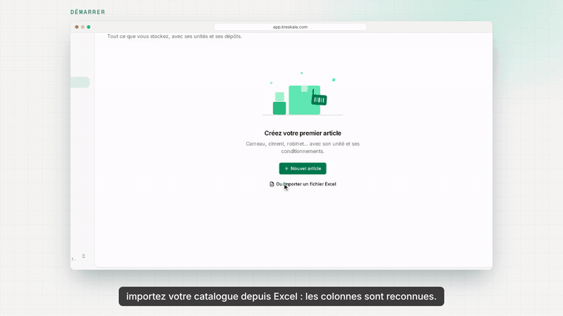
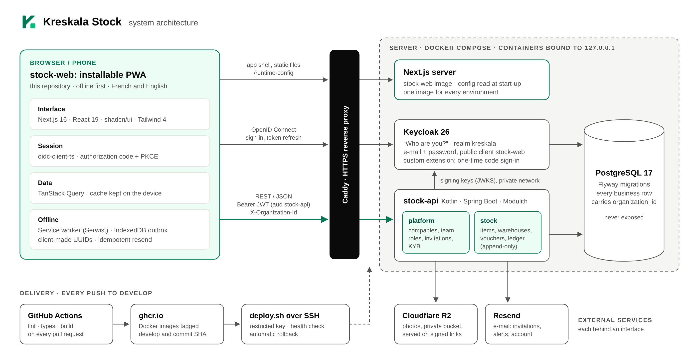

# Kreskala Stock: web application

Stock management for small and medium businesses: receipts, issues, transfers and stock counts
across several warehouses, down to the carton, even without a network. Built first for building
materials retailers in Cameroon (tiles, plumbing, hardware), in French and English.

This repository is the web client: an installable, offline-first PWA written in TypeScript with
Next.js 16 and React 19. It talks to a Kotlin / Spring Boot API (`stock-api`, a separate
repository) and signs users in through Keycloak.

*Version française : [README.fr.md](README.fr.md).*

## Demo

[](docs/media/kreskala-presentation.mp4)

Full presentation (2 min 40, French voice-over):
[docs/media/kreskala-presentation.mp4](docs/media/kreskala-presentation.mp4).

## What it does

- **Catalogue**: items with photos, packaging conversions (carton, m², piece), batches with shade
  and calibre, barcodes, printable label sheets, Excel or CSV import.
- **Stock movements**: receipts, issues, transfers between warehouses, breakage, adjustments,
  customer and supplier returns. Every validated voucher is numbered and printable as a PDF
  under the company's letterhead.
- **Controls**: issues can require a manager's approval, a receipt records the gap with the
  delivery note, a mix of shades on one voucher raises a warning.
- **Stock counts** per warehouse, storage locations, configurable low-stock alerts.
- **Team**: invitations, roles and warehouses per member, in-app and e-mail notifications.
- **Dashboards and reports** per role, with exports.
- **Offline**: vouchers are entered without a network, kept on the phone and sent when the
  connection returns, without duplicates.

## Architecture



Vector version: [docs/architecture.svg](docs/architecture.svg).

- **The browser calls the API and Keycloak directly.** The Next.js server only delivers the
  application and its runtime configuration (`/runtime-config`), so a single Docker image serves
  every environment.
- **Keycloak answers "who are you?"** (OpenID Connect, authorization code with PKCE). The API
  answers "which company, which role?": every request carries the access token and the active
  company in `X-Organization-Id`, and the API checks the membership each time.
- **Offline first**: the service worker (Serwist) keeps the application and the field screens;
  reads are cached on the device with TanStack Query; vouchers wait in an IndexedDB outbox.
  Identifiers are UUIDs created on the client, so a resend never creates a duplicate.
- **Stock is a ledger**: a movement is never edited, a correction is a new voucher.

The reasoning behind each choice is kept in [DECISIONS.md](DECISIONS.md) (in French), and the
data model in [docs/modele-donnees.html](docs/modele-donnees.html).

## Tech stack

| Area | Tools |
|---|---|
| Framework | Next.js 16 (App Router), React 19, TypeScript |
| Interface | shadcn/ui on Base UI, Tailwind CSS 4, Recharts |
| Data | TanStack Query with a persisted cache, Zod, React Hook Form |
| Authentication | Keycloak 26, `oidc-client-ts`, `react-oidc-context` |
| Offline | Serwist service worker, IndexedDB (`idb-keyval`) |
| Documents | `@react-pdf/renderer`, `bwip-js` barcodes, Excel and CSV import and export |
| Languages | `next-intl`, French and English |
| Tests | Playwright end-to-end suite against the real stack |
| Delivery | GitHub Actions, Docker image on ghcr.io, deployment over SSH |

## Run it locally

Prerequisite: the `stock-api` stack (PostgreSQL, Keycloak, API) running locally.

```bash
cp .env.example .env.local   # Keycloak and API addresses
npm install
npm run dev                  # http://localhost:3100
```

Open http://localhost:3100/connexion and choose "Créer un compte". Confirmation e-mails land in
the local Mailpit inbox at http://localhost:8025.

| Variable | Role |
|---|---|
| `KEYCLOAK_URL` | Keycloak address |
| `KEYCLOAK_REALM` | realm (`kreskala`) |
| `KEYCLOAK_CLIENT_ID` | public client (`stock-web`) |
| `API_URL` | `stock-api` address |

## Checks

```bash
npm run typecheck && npm run lint && npm run build
npm run test:e2e   # full journeys against the real stack, see e2e/README.md
```

## Project layout

| Folder | Content |
|---|---|
| `app/(app)` | signed-in area: dashboard, stock, vouchers, items, warehouses, team, settings |
| `components` | screens and UI components (`components/ui`: shadcn components) |
| `lib/api` | HTTP client (token, language, active company, RFC 9457 errors), TanStack Query requests |
| `lib/auth` | OpenID Connect sign-in (Keycloak, PKCE) |
| `lib/offline`, `lib/service-worker` | outbox, catalogue copy, caching rules |
| `lib/pdf`, `lib/labels`, `lib/import` | PDF documents, barcode labels, catalogue import |
| `messages` | French and English texts; French is the typed reference |
| `e2e` | Playwright journeys |

## Continuous integration

`.github/workflows/ci.yml` runs lint, type checks and the build on every pull request to
`develop` or `main`. On each push to `develop`, it also publishes the Docker image to ghcr.io and
updates the web service of the staging environment, with a health check and a rollback to the
previous version if it fails.
